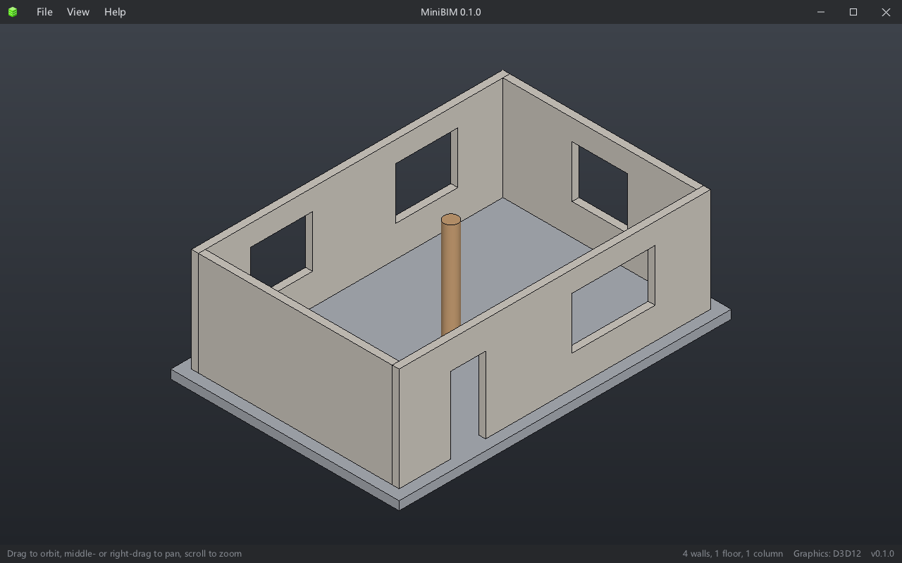

<p align="center">
  
</p>

<h1 align="center">MiniBIM</h1>

<p align="center">
  <strong>An open-source BIM application written in C++20.</strong><br />
  Runs on Windows, models with the SMLib solid kernel, ports its BIM features from BIMCraft, and speaks several languages.
</p>

<p align="center">
  <a href="https://github.com/CHMOSE023/MiniBIM/releases">Download for Windows</a> ·
  <a href="README_CN.md">简体中文</a>
</p>

<p align="center">
  <a href="https://github.com/CHMOSE023/MiniBIM/actions/workflows/build.yml"></a>
  <a href="https://github.com/CHMOSE023/MiniBIM/releases/latest"></a>
  <a href="https://github.com/CHMOSE023/MiniBIM/releases"></a>
  <a href="LICENSE"></a>
  <a href="https://qm.qq.com/q/O08yWfRvmE"></a>
  <a href="https://github.com/CHMOSE023/MiniBIM/stargazers"></a>
</p>



MiniBIM reuses the user interface and renderer of [MiniCAD](https://github.com/CHMOSE023/MiniCAD), models with the SMLib
geometry kernel, and is porting its BIM features from [BIMCraft](https://github.com/IPedrax/BIMCraft). The interface is multilingual.

> MiniBIM is at stage 1 (the skeleton): the window, menus, 3D view and language switching work, and the model is a temporary
> demo house. What comes next is in [docs/PLAN.md](docs/PLAN.md) (in Chinese).

### Building on Windows

You need CMake 3.20+, Ninja and Visual Studio (MSVC, C++20).

```bat
build.bat
out\debug\MiniBIMWin\MiniBIMWin.exe
```

Outside a Visual Studio developer environment, `build.bat` finds Visual Studio and runs `vcvars64.bat` itself. Inside a
"Developer Command Prompt for VS" you can also run:

```bat
cmake --preset debug
cmake --build --preset debug
```

`build.bat release` builds the release version (a windowed program without a console).

Command-line options: `--lang zh_CN` (the language for this run only), `--gpu d3d12|d3d11|warp` (or the environment variable
`MINIBIM_GPU`), `--ui <interface description file.json>`.

### Tests

```bat
run_tests.bat
```

It builds, runs `ctest` (translations, the camera, an SMLib smoke test) and checks that the translation catalogs are up to date
(`tools/extract_messages.py --check`) and that every icon the interface uses is generated (`tools/make_icons.py --check`). GitHub Actions builds and tests the Windows version on every pull request to `main`, and
packages and publishes a release when a `v*` tag is pushed (`.github/workflows/build.yml`).

### Languages

Interface text is written in English in the code and translated at run time from gettext catalogs (`assets/i18n/*.po`). Pick a
language under File > Language, or follow the system's. Simplified Chinese and English are available today. A new language is
one `.po` file, with no code changes, and translations are welcome. See [docs/i18n.md](docs/i18n.md) (in Chinese) for how it
works.

### Layout

| Directory | Contents |
|---|---|
| `src/` | The `MiniBIM` core library: translations (`I18n/`), the camera (`View/`), math and renderer interfaces (`Core/`, `Render/`), the solid kernel interface (`Solid/`) |
| `src/UI/` | The MiniGUI interface library (copied from MiniCAD) |
| `apps/Common/` | The main window's interface and logic (platform-independent) |
| `apps/Render/` | Renderers (D3D12, D3D11) |
| `apps/Win32/` | The Windows desktop host |
| `assets/` | The interface description `ui/minibim_ui.json`, the catalogs in `i18n/` and the icons in `icons/` |
| `3rd/` | SMLib (NURBS B-rep solid kernel, Apache-2.0) and stb |
| `tools/` | `extract_messages.py`: collects interface text and updates the catalogs; `make_icons.py`: draws every icon MiniBIM uses |
| `tests/` | Tests |
| `.agents/` | Notes, feature guides and skills for AI coding assistants (start at [AGENTS.md](AGENTS.md)) |

### License

MiniBIM is released under the [MIT License](LICENSE). Third-party components (SMLib is Apache-2.0) and the code MiniBIM is
ported from are listed in [THIRD_PARTY_NOTICES.md](THIRD_PARTY_NOTICES.md).

---

<sub>Autodesk and Revit are trademarks of Autodesk, Inc. MiniBIM is an independent open-source project and is not affiliated with Autodesk. IFC is an open standard of buildingSMART International (ISO 16739).</sub>
