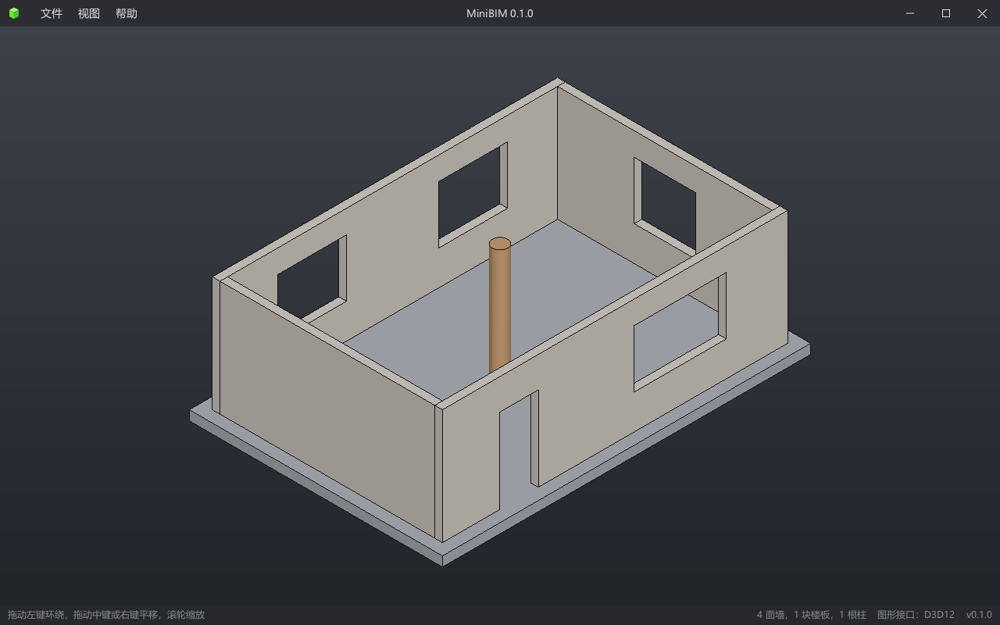

<p align="center">
  
</p>

<h1 align="center">MiniBIM</h1>

<p align="center">
  <strong>开源 BIM 软件，使用 C++20 开发。</strong><br />
  在 Windows、Linux 和浏览器里运行，几何内核使用 SMLib，建模功能移植自 BIMCraft，界面支持多语言。
</p>

<p align="center">
  <a href="https://github.com/CHMOSE023/MiniBIM/releases">下载</a>（Windows、Linux、网页版） ·
  <a href="README.md">English</a>
</p>

<p align="center">
  <a href="https://github.com/CHMOSE023/MiniBIM/actions/workflows/build.yml"></a>
  <a href="https://github.com/CHMOSE023/MiniBIM/releases/latest"></a>
  <a href="https://github.com/CHMOSE023/MiniBIM/releases"></a>
  <a href="LICENSE"></a>
  <a href="https://qm.qq.com/q/O08yWfRvmE"></a>
  <a href="https://github.com/CHMOSE023/MiniBIM/stargazers"></a>
</p>



MiniBIM 的界面与渲染沿用 [MiniCAD](https://github.com/CHMOSE023/MiniCAD)，几何内核使用 SMLib，
建模功能移植自 [BIMCraft](https://github.com/IPedrax/BIMCraft)，界面支持多语言。

0.2.0 版已经移植了 BIMCraft 的模型、界面与其余各个选项卡：

- **模型**：标高、轴网、墙、楼板、天花板、屋顶、房间、门窗、族与构件及其类型与材质、柱；每次编辑都是可撤销的命令；
  项目文件（`.minibim`，与 BIMCraft 的 `.bimcraft` 同一格式）
- **视图**：经 SMLib 建模的三维、各标高的平面、剖面与立面、明细表、图纸、可见性 / 图形替换、视图样板与过滤器
- **选项卡**：建筑、结构、卫浴、电气、防雷、数据、插入、注释、体量、修改、视图、管理
- **交换**：IFC（读 IFC2x3 / IFC4，写 IFC4）、Revit 项目（`.rvt`，只读，列出没带进来的内容）、链接模型、
  DXF 导入与链接、点云（PTS、XYZ、PLY、LAS、E57）

各版本的内容见 [docs/release-notes](docs/release-notes)；后面的移植计划（楼梯、坡道与栏杆，组，阶段与设计选项等）见 [docs/PLAN.md](docs/PLAN.md)。

### Windows 版编译

需要 CMake 3.20+、Ninja、Visual Studio（MSVC，C++20）。

```bat
build.bat
out\debug\MiniBIMWin\MiniBIMWin.exe
```

`build.bat` 不在 VS 开发环境里时会自己找到 VS 并调用 `vcvars64.bat`；已经在 "Developer Command Prompt for VS" 里时也可以直接：

```bat
cmake --preset debug
cmake --build --preset debug
```

发布版用 `build.bat release`（窗口程序，没有控制台）。

启动参数：`--lang zh_CN`（只对这一次启动指定语言）、`--gpu d3d12|d3d11|warp`（也可以用环境变量 `MINIBIM_GPU`）、`--ui <界面描述文件.json>`。

### Linux 版编译

需要 CMake 3.20+、Ninja、GCC 13+ 或 Clang（C++20）、OpenGL ES 3 / EGL 开发包、[SDL3](https://github.com/libsdl-org/SDL)。以 Ubuntu / Debian 为例：

```bash
sudo apt install build-essential cmake ninja-build pkg-config libegl-dev libgles-dev \
    libx11-dev libxext-dev libxrandr-dev libxcursor-dev libxi-dev libxfixes-dev libxss-dev libxtst-dev \
    libxkbcommon-dev libwayland-dev wayland-protocols libdbus-1-dev libudev-dev
```

Vulkan 后端（可选，有就先用它，不行时改用 OpenGL ES 3）还要头文件与着色器编译器：

```bash
sudo apt install libvulkan-dev glslang-tools mesa-vulkan-drivers
```

SDL3：Ubuntu 25.04 / Debian 13 起可以 `sudo apt install libsdl3-dev`；更早的发行版从源码编译安装（例如装到 `~/sdl3`）：

```bash
cmake -S SDL3-3.4.18 -B sdl3-build -G Ninja -DCMAKE_BUILD_TYPE=Release -DCMAKE_INSTALL_PREFIX=$HOME/sdl3 -DSDL_TESTS=OFF
cmake --build sdl3-build && cmake --install sdl3-build
```

编译 MiniBIM（SDL3 装在系统目录时去掉 `CMAKE_PREFIX_PATH`）：

```bash
cmake -S . -B out/linux -G Ninja -DCMAKE_BUILD_TYPE=Release -DCMAKE_PREFIX_PATH=$HOME/sdl3
cmake --build out/linux
out/linux/MiniBIMLinux/MiniBIMLinux [项目文件]
```

找不到 SDL3 或 OpenGL ES 3 时只编译核心库与测试（`ctest --test-dir out/linux`）；找不到 Vulkan 开发文件时只用 OpenGL ES 3。
启动参数同 Windows 版，`--gpu vulkan|gl`。打开、保存的文件对话框需要 xdg-desktop-portal 或 zenity。

### 网页版编译

需要 [Emscripten SDK](https://emscripten.org)（`build_wasm.bat` 默认在 `D:\dev\emsdk`，在脚本开头的 `EMSDK_ENV` 改）。

```bat
build_wasm.bat serve
```

输出到 `out/build/wasm/MiniBIMWeb/`，并在 http://localhost:8080/MiniBIMWeb/ 启动本地服务器。网页版默认用浏览器的 WebGPU，不支持时改用 WebGL2
（网址加 `?webgl` 强制用 WebGL2）。打开时把选中的文件读进页面；保存、导出 IFC 先问文件名，再由浏览器下载。不自动保存，也不记住设置。
第一次构建时 Emscripten 从 GitHub 下载 WebGPU 绑定（emdawnwebgpu 端口包），需要联网。

### 测试

```bat
run_tests.bat
```

编译后运行 `ctest`（模型、命令、IFC、Revit 读取器、三维场景、主窗口、多语言、相机、SMLib 冒烟测试），再检查词典是否需要更新（`tools/extract_messages.py --check`）、
界面用到的图标是否都已生成（`tools/make_icons.py --check`）。
GitHub Actions 在每个到 `main` 的 PR 上编译 Windows 版、Linux 版和网页版并运行测试，推送 `v*` 标签时打包并发布（`.github/workflows/build.yml`）。

### 多语言

界面文字在代码里写英文原文，运行时按词典（`assets/i18n/*.po`，gettext 格式）翻译；"文件 > 语言"里切换，或跟随系统语言。
现在有简体中文、英文、西班牙语和葡萄牙语；新增一种语言只需要加一个 `.po` 文件，不用改代码，欢迎提交译文。做法见 [docs/i18n.md](docs/i18n.md)。

### 目录

| 目录 | 内容 |
|---|---|
| `src/` | 核心库 `MiniBIM`：多语言（`I18n/`）、相机与模型的三维场景（`View/`）、数学与渲染接口（`Core/`、`Render/`）、实体内核接口（`Solid/`） |
| `src/Model/`、`src/Commands/` | 建筑模型、命令与撤销（移植自 BIMCraft） |
| `src/Ifc/` | IFC 交换：STEP 的读法、IFC4 导出、IFC2x3 / IFC4 导入 |
| `src/Rvt/` | Revit 文件读取器（Apache-2.0，见"许可"） |
| `src/UI/` | 界面库 MiniGUI（复制自 MiniCAD） |
| `apps/Common/` | 主窗口的界面与逻辑（与平台无关） |
| `apps/Render/` | 渲染后端（Windows 为 D3D12、D3D11，Linux 为 Vulkan、OpenGL ES 3，网页为 WebGPU、WebGL2） |
| `apps/Win32/`、`apps/Linux/`、`apps/Web/` | Windows 桌面版宿主；Linux 版宿主（SDL3）；网页版宿主（Emscripten） |
| `assets/` | 界面描述文件 `ui/minibim_ui.json`、词典 `i18n/`、图标 `icons/`、Linux 版与网页版的界面字体 `fonts/` |
| `3rd/` | SMLib（NURBS BRep 实体内核，Apache-2.0）、stb、nlohmann/json（MIT） |
| `tools/` | `extract_messages.py`：收集界面原文、更新词典；`make_icons.py`：生成 MiniBIM 用到的全部图标；`make_web_font.py`：生成 Linux 版与网页版的界面字体 |
| `tests/` | 测试 |
| `.agents/` | AI 编程助手的说明、功能指南与 skill（入口是 [AGENTS.md](AGENTS.md)） |

### 许可

MiniBIM 按 [MIT 许可证](LICENSE) 发布。第三方组件（SMLib 为 Apache-2.0）与移植来源见 [THIRD_PARTY_NOTICES.md](THIRD_PARTY_NOTICES.md)。
`src/Rvt/` 的 Revit 文件读取器（移植自 BIMCraft，其中一部分又移植自 rvt-rs）只有 Apache-2.0、不是 MIT；默认编入它的程序（开关 `MINIBIM_WITH_RVT`）
附带它的许可原文与声明 `LICENSE-Rvt`、`NOTICE-Rvt`。
 
---

<sub>Autodesk 与 Revit 是 Autodesk, Inc. 的商标。MiniBIM 是独立的开源项目，与 Autodesk 没有关联。IFC 是 buildingSMART International 的开放标准（ISO 16739）。</sub>